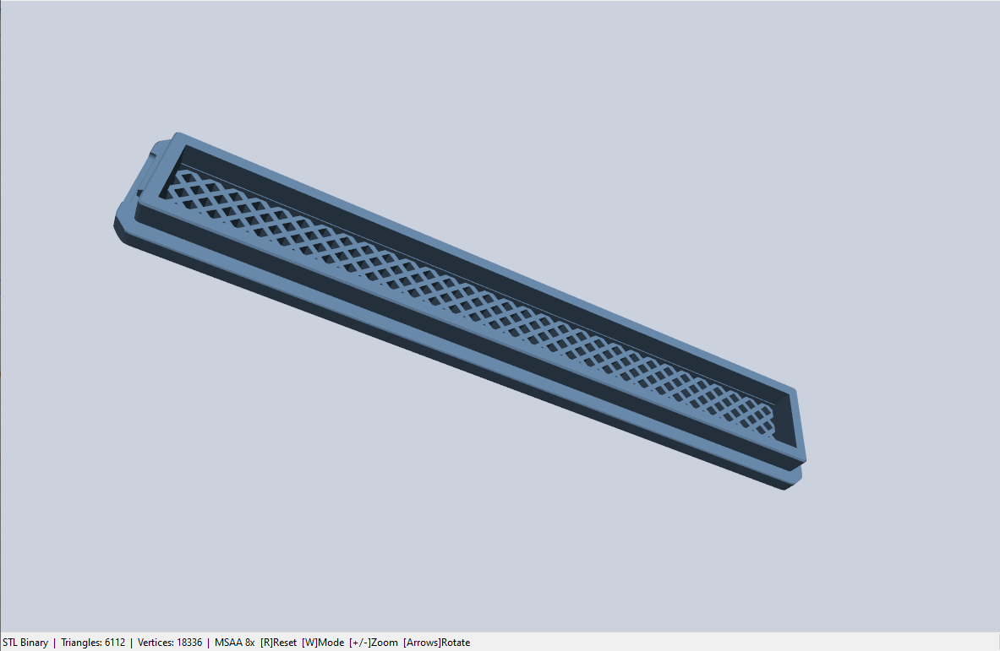

# 3MF Viewer – Total Commander Lister Plugin

Interaktiver OpenGL-Viewer für 3D-Modelle und G-Code im Total Commander Lister.  
Basiert auf **lib3mf 2.5.0**, **OpenCascade 7.6.1** für STEP und Direct Win32/WGL – kein LCL-Framework.




---

## Unterstützte Formate

| Erweiterung | Format | Lade-Bibliothek |
|---|---|---|
| `.3mf` | 3D Manufacturing Format | lib3mf 2.5.0 |
| `.stl` | Stereolithography (Binary + ASCII) | Eingebaut |
| `.stp`, `.step` | STEP-BREP, einschließlich B-Spline-/NURBS-Flächen | Native `step_import.dll` (OpenCascade) |
| `.gcode`, `.gco`, `.nc`, `.ngc`, `.g` | 3D-Druck-G-Code | Eingebaut |

SVG und DXF werden nicht unterstützt.

### Große STL-Dateien

ASCII-STL hat keine feste 64-MiB-Grenze mehr. Der Importer liest den Quelltext
blockweise in zwei Durchläufen statt als vollständigen Text plus Zeilenliste.
Im RAM liegen der Lesepuffer, die aktuelle Zeile und die fertige Geometrie.
Überlauf-/Adressraumprüfungen bleiben erhalten; die praktisch mögliche Größe
hängt insbesondere vom verfügbaren Speicher ab (Geometrie/Indizes etwa 96 Byte
pro Dreieck). Win32 hat entsprechend engere Speichergrenzen als Win64.

Die bestehende Erkennung von **Binär-STL unter 4 GiB** ist davon unabhängig und
wurde nicht auf größere Binärdateien erweitert. Getestet sind synthetische
ASCII-Dateien mit 68.157.533 Bytes und 554.126 Dreiecken auf beiden Targets.

### lib3mf – unterstützte 3MF-Inhalte

lib3mf implementiert die **3MF Core Specification** sowie folgende Extensions:

- **Mesh-Objekte** – Dreiecksnetze mit Vertices und Normalen
- **Components** – Instanzen / Referenzen auf andere Objekte einschließlich ihrer Transformationen
- **Build-Items** – Transformationen und Anordnung im Bauraum
- **Materials & Properties Extension** – Farben, Texturen, Multi-Properties
- **Beam Lattice Extension** – Gitterstrukturen
- **Slice Extension** – 2D-Schichtdaten
- **Production Extension** – UUIDs, Pfad-basierte Struktur
- **Secure Content Extension** – Verschlüsselung

> **Projekt-3MF:** Komponenten werden rekursiv über die Build-Items aufgelöst.
> Damit stellt der Viewer auch von Slicern erzeugte Projektdateien mit mehreren
> Druckplatten an ihren gespeicherten Positionen dar (unter anderem Bambu Studio).
> Für Bambu-Studio-Projekte werden zudem die gespeicherten Plattennamen (z. B.
> „Set – Funnel Saver + Box Large + Funnel“) an der jeweiligen Plattengruppe im
> Viewer und im Thumbnail eingeblendet.
> Die Namen liegen als texturierte Flächen auf der XY-Ebene (Z=0) oberhalb der
> jeweiligen Objektgruppe und drehen und skalieren mit dem Modell. Bei einer
> Kantenansicht werden sie entsprechend perspektivisch schmal; von unten
> erscheinen sie spiegelverkehrt.

### STEP-Import

STEP wird mit OpenCascade gelesen und tesselliert, einschließlich Kurven,
getrimmter Flächen, Innenkonturen, Platzierungen und Flächennormalen.
Viewer und Thumbnails verwenden denselben nativen Importpfad. Der frühere
Polygon-Importer wird nicht mehr verwendet, auch nicht als stiller Fallback.
Fehlt die Hilfs-DLL oder hat sie die falsche Architektur/Schnittstelle,
erscheint ein entsprechender Fehler.

Die architekturpassende `step_import.dll` liegt direkt neben der WLX-Datei.
Sie wird nur für den Import geladen;
nach Kopie der Geometrie und Freigabe des CAD-Modells wird sie wieder entladen.
Parallele Viewer-/Thumbnail-Importe sind serialisiert. Die Gleitkomma-Umgebung
wird für den C++-Kern vereinheitlicht und danach wiederhergestellt.

Tessellierung: 0,05 mm lineare und 0,35 rad Winkelabweichung. Das Laden bleibt
synchron mit Wartebild. Falls Flächen keine Dreiecke liefern, zeigt der Status
`Unmeshed faces: ...`; es werden keine Löcher heuristisch zugedeckt. Bei der
Lutronic-Testdatei betrifft das aktuell drei Flächen; deren Ursache ist offen.

Die aktuelle DLL-Schnittstelle liest **nur STEP**. Die zugrunde liegenden Quellen
enthalten zusätzlich IGES- und natives BREP-Importieren; diese Formate sind
nicht über die aktuelle DLL-Schnittstelle und nicht im Plugin freigeschaltet.
FreeCAD-Projektarchive, OBJ und andere CAD-Formate werden dadurch nicht automatisch
unterstützt. Vorgeschichte: [`test/occt_probe/README.md`](test/occt_probe/README.md).

---

## Steuerung

| Eingabe | Aktion |
|---|---|
| Linke Maustaste + Ziehen | Freier Trackball: bildschirmbezogen drehen; am Rand um die Blickachse rollen |
| Rechte Maustaste + Ziehen | Bildschirmparallel verschieben: rechts bleibt rechts, hoch bleibt hoch |
| `Shift` + linke Maustaste + Ziehen | Lichtrichtung drehen |
| `Shift` + rechte Maustaste + Ziehen | Lichtstärke regeln (hochziehen = heller) |
| Mausrad | Zum Punkt unter dem Mauszeiger zoomen |
| Doppelklick | Ansicht zurücksetzen |
| `R` / `F5` | Ansicht zurücksetzen |
| `W` | Modus: Solid → Solid+Drahtgitter → Drahtgitter |
| Pfeiltasten | 5°-Rotation um Bildschirmachsen |
| `+` / `-` | Zoom |

TC Dark-Mode wird automatisch erkannt (`lcp_darkmode`-Flag).

Die Trackball-Rotation gilt für Mesh-Dateien und G-Code. Ziehen über die
Ansichtsmitte dreht in die sichtbare Richtung, auch nach vorheriger Drehung
oder in einer Ansicht von unten. Ziehen entlang des äußeren Trackball-Rands
rollt das Modell um die Blickachse. Es gibt keine Höhenwinkelbegrenzung und
keine feste Aufwärtsachse; Reset und die G-Code-Ansichtstasten bleiben verfügbar.

Verschieben und Mauszoom gelten für Mesh-Dateien und G-Code unabhängig von der
aktuellen Drehung. Beim Mausrad bleibt der anvisierte Punkt an seiner
Bildschirmposition; Teilraster des Mausrads werden berücksichtigt. Die Tasten
`+` / `-` zoomen weiterhin um die Ansichtsmitte. `Shift` + rechte Maustaste
ändert weiterhin nur die Lichtstärke.

Das Wartebild belegt bereits während des Ladens den gesamten Lister-Innenbereich,
auch beim Wechsel zur nächsten Datei; es startet nicht mehr mit 400×300 Pixeln.

Im G-Code-Modus stehen zusätzlich Layer-, Support-, Travel- und
Linienbreitenoptionen im rechten Bedienfeld zur Verfügung. `G92`-Resets für
Position und Extruder werden berücksichtigt.

### G-Code-Druckvorschau

- Druckbahnen sind verbundene, abgeflacht-runde Extrusionskörper mit achtseitigem
  Querschnitt statt einzelner Quader. Die Oberkante liegt auf der G-Code-Z-Höhe,
  die Unterkante eine Schichthöhe darunter. Auch das erste Segment nach Travel
  wird dargestellt.
- Breite und Höhe stammen zunächst aus den Slicer-Kommentaren `LINE_WIDTH`,
  `LAYER_HEIGHT`, `WIDTH` und `HEIGHT` (ohne Angaben: 0,4 / 0,2 mm).
  „Line width: slicer“ zeigt diesen Automatikmodus. Betätigen des Breitenreglers
  überschreibt die Breite in mm bis zum nächsten Laden einer Datei.
- `G2/G3`-Bögen auf der XY-Ebene werden mit maximal 0,025 mm Sehnenabweichung
  angenähert; I/J-Mittelpunkte, R-Radien, Vollkreise und helikale Z-Verläufe
  werden berücksichtigt. Kein vollständiger CNC-/Firmware-Interpreter;
  die Druckvorschau ist für millimeterbasierten XY-Druck-G-Code ausgelegt.
- Geometrie liegt einmalig in OpenGL-Vertex-/Indexpuffern, gruppiert nach Layer
  und Feature. Drehen, Licht, Farbmodus und Sichtbarkeits-/Layerfilter verwenden
  dieselben Puffer weiter. Nur eine manuelle Breitenänderung baut sie neu auf,
  beim Ziehen erst nach Loslassen des Reglers.
- „Lighting“ schaltet nur die Beleuchtung um, nicht mehr zwischen Körpern und
  dünnen Linien. Viewer und Thumbnail verwenden denselben Geometrie-Renderer.
- Der Parser liest große Dateien blockweise statt als vollständige Zeilenliste.
  Auch Bewegungen werden in kleinen Blöcken gespeichert, damit Win32 keinen
  mehrere Hundert MB großen zusammenhängenden Speicherbereich benötigt.
  Die Bewegungsdaten und GPU-Geometrie bleiben größenabhängig im Speicher;
  das Laden selbst erfolgt weiterhin synchron mit Wartebild.

Die Geometrie ist eine native Pascal-Adaption von Teilen aus
[gcode-preview](https://github.com/xyz-tools/gcode-preview), nicht die Einbettung
seines TypeScript-/three.js-Viewers. Es werden kein Browser und keine zusätzliche
JavaScript-Laufzeit benötigt. Lizenzhinweis siehe unten.

---

## Voraussetzungen

- **Total Commander 64-bit** für `3mfviewer.wlx64`, oder **32-bit** für `3mfviewer.wlx`
- **Windows 10/11** (x86 oder x64, passend zu Total Commander)
- **OpenGL 1.5+** (auf jedem Windows-System mit aktuellem Grafiktreiber vorhanden)
- Für `3mfviewer.wlx64`: **`lib3mf.dll`** muss im selben Verzeichnis liegen
- Für `3mfviewer.wlx`: **`lib3mf_32bit.dll\lib3mf.dll`** muss relativ zum Plugin liegen
- Für STEP zusätzlich die architekturpassende **`step_import.dll` direkt neben
  der WLX**; gemeinsame Lizenz-/Hinweisdateien unter `native/`

Da beide Architekturen denselben DLL-Namen verwenden, Win32 und Win64 mit
STEP-Unterstützung in getrennten Plugin-Ordnern bereitstellen.

Die STEP-DLL enthält OpenCascade und die C++-Laufzeit. Keine separate VC++-Runtime,
TBB-, FreeType-, Node.js-, Browser- oder WASM-Installation ist für diesen Build
erforderlich. Direkte Imports sind Windows-Systembibliotheken.

Dateipfade werden für 3MF, STL, STEP und G-Code intern über Unicode-Windows-APIs
geöffnet. Die Thumbnail-Schnittstelle von WLX selbst übergibt ihren Dateinamen
lediglich als ANSI-Zeichenkette.

---

## Build

### Voraussetzungen

- **Lazarus 3.x** mit **FPC 3.2.x**, Toolchain `x86_64-win64`
  Download: https://www.lazarus-ide.org/

> Kein LCL-Paket erforderlich. Das Plugin verwendet nur FPC RTL + Windows-API.

### Lazarus IDE

1. `File → Open Project` → `3mfviewer.lpi`
2. Build-Modus **Release 64** oder **Release 32**
3. `Run → Build` (`Shift+F9`)
4. Ausgabe: `3mfviewer.wlx64`

### Kommandozeile

```bat
lazbuild 3mfviewer.lpi --build-mode="Release 64"
lazbuild 3mfviewer.lpi --build-mode="Release 32"
```

Die nativen STEP-Helfer bei Bedarf separat bauen (MSVC Build Tools 2022 + SDK;
beim ersten Build die im Probebericht gepinnten Quellen beziehen):

```powershell
./test/occt_probe/build.ps1 x64
./test/occt_probe/build.ps1 Win32
./native/stage.ps1 -Target 64
# Alternativ für einen Win32-Testlauf im Projekt: ./native/stage.ps1 -Target 32
```

`cl.exe` läuft dabei mit BelowNormal-Priorität. `stage.ps1` stellt ausschließlich
Dateien im Projekt bereit, installiert nichts und verändert keine Archive.
Der MSVC-Release-Build sichert `/O2 /Ob2 /DNDEBUG` für den CAD-Kern und die
Hilfs-DLL explizit ab, auch bei einem älteren CMake-Cache. `/fp:fast` wird nicht
verwendet; Importparameter und Tessellierungsqualität bleiben unverändert.
Der gemessene Picatinny-Ladevorgang im Win64-Viewer sank dadurch von 16,3 auf
4,0 Sekunden; CAD-Aufbau von etwa 10,1 auf 2,2 Sekunden. Messaufbau und Grenzen:
[`test/step_optimized_performance.md`](test/step_optimized_performance.md).
Die beiden Buildprodukte verbleiben unter `native/win32` und `native/win64`;
zusätzlich wird die gewählte DLL als `step_import.dll` ins Projektverzeichnis
kopiert. Dort kann jeweils nur eine Architektur zugleich liegen.

---

## Installation in Total Commander

1. Architekturpassende Dateien bereitstellen:
   - 64 Bit: `3mfviewer.wlx64` und `lib3mf.dll` im selben Verzeichnis
   - 32 Bit: `3mfviewer.wlx` sowie `lib3mf_32bit.dll\lib3mf.dll`
   - Für STEP die passende DLL aus `native/win64` bzw. `native/win32` als
     `step_import.dll` direkt neben die jeweilige WLX legen. Beide Architekturen
     dafür in getrennten Ordnern halten; gemeinsame Lizenz-/Hinweisdateien
     unter `native/` mitnehmen.

2. In TC: `Konfiguration → Optionen → Plugins → Lister Plugins → Hinzufügen`

3. TC speichert den Detect-String für 3MF, STL, STEP und G-Code automatisch.

> **Beim Build:** TC muss geschlossen sein, da die geladene DLL gesperrt wird
> (Windows Error 5 = Access Denied).

---

## Projektstruktur

```
3mfviewer/
├── 3mfviewer.lpi          Lazarus-Projektdatei
├── 3mfviewer.lpr          Library-Einstiegspunkt (Exports)
├── plugin_main.pas        WLX-Exports + Fenster-Lifecycle
├── viewer_form.pas        Win32-Fenster, WGL/OpenGL, Splash, Steuerung
├── mesh_data.pas          3MF/STL/STEP-Laden, Normalen, Bounding Sphere
├── native_step.pas        STEP-C-ABI, Unicode-Laden, Datenkopie und DLL-Lebensdauer
├── camera_rotation.pas    Freier Quaternion-Trackball in Bildschirmkoordinaten
├── native/               Architekturgetrennte STEP-DLLs und Lizenzhinweise
├── gcodeparser.pas        G-Code-Parser mit Layer- und Feature-Erkennung
├── gcode_geometry.pas     Extrusionsbahnen, Bögen und begrenzte Geometrie-Chunks
├── gcode_gl_renderer.pas  Kontextgebundener OpenGL-Puffercache (auch Thumbnail)
├── listplug.pas           WLX SDK Header v2.12
└── lib3mf/
    └── Unit_Lib3MF.pas    Pascal-Bindings (auto-generiert, ACT 1.8.1)
```

---

## Lizenzen

### Dieses Plugin

Frei verwendbar ohne Einschränkungen.
Die folgenden Drittanbieter-Lizenzhinweise sind bei Weitergabe zu beachten.

### gcode-preview – MIT License

Die elliptischen Extrusionsringe, Eckentangenten und der Z-Schichthöhenversatz
in `gcode_geometry.pas` sind aus `src/extrusion-geometry.ts` adaptiert:
[xyz-tools/gcode-preview](https://github.com/xyz-tools/gcode-preview/tree/4f2b58faebe97ca15ee2c901b6c487b8ad34e3e7).
Copyright (c) 2017–2025 Remco Veldkamp. Vollständige MIT-Lizenz einschließlich
Copyright-Hinweis: `third_party/gcode-preview-LICENSE.txt`; bei Weitergabe des
Plugins mitliefern. Parser, Win32-Integration und nativer OpenGL-Puffercache
bleiben projektspezifisch.

### OpenCascade / occt-import-js – LGPL

Die native STEP-Hilfs-DLL enthält occt-import-js (LGPL 2.1) und OpenCascade 7.6.1
(LGPL 2.1 mit OCCT-Ausnahme). Die zugehörigen Lizenztexte und Herkunftshinweise
liegen unter `native/`. Diese Hinweise bei Weitergabe mitliefern und die
weiteren Lizenzbedingungen der Bibliotheken beachten. Gepinnte Quellen,
Wrapper und reproduzierbarer Build liegen unter `test/occt_probe/`.
Es wurde kein TypeScript-/three.js-Viewer in das Plugin übernommen.

### lib3mf – BSD 2-Clause License

`lib3mf.dll` und `Unit_Lib3MF.pas` unterliegen der **BSD 2-Clause License**:

```
Copyright (C) 2024 3MF Consortium

Redistribution and use in source and binary forms, with or without
modification, are permitted provided that the following conditions are met:

1. Redistributions of source code must retain the above copyright notice,
   this list of conditions and the following disclaimer.

2. Redistributions in binary form must reproduce the above copyright notice,
   this list of conditions and the following disclaimer in the documentation
   and/or other materials provided with the distribution.

THIS SOFTWARE IS PROVIDED BY THE COPYRIGHT HOLDERS AND CONTRIBUTORS "AS IS"
AND ANY EXPRESS OR IMPLIED WARRANTIES, INCLUDING, BUT NOT LIMITED TO, THE
IMPLIED WARRANTIES OF MERCHANTABILITY AND FITNESS FOR A PARTICULAR PURPOSE
ARE DISCLAIMED. IN NO EVENT SHALL THE COPYRIGHT HOLDER OR CONTRIBUTORS BE
LIABLE FOR ANY DIRECT, INDIRECT, INCIDENTAL, SPECIAL, EXEMPLARY, OR
CONSEQUENTIAL DAMAGES (INCLUDING, BUT NOT LIMITED TO, PROCUREMENT OF
SUBSTITUTE GOODS OR SERVICES; LOSS OF USE, DATA, OR PROFITS; OR BUSINESS
INTERRUPTION) HOWEVER CAUSED AND ON ANY THEORY OF LIABILITY, WHETHER IN
CONTRACT, STRICT LIABILITY, OR TORT (INCLUDING NEGLIGENCE OR OTHERWISE)
ARISING IN ANY WAY OUT OF THE USE OF THIS SOFTWARE, EVEN IF ADVISED OF THE
POSSIBILITY OF SUCH DAMAGE.
```

Quelle: https://github.com/3MFConsortium/lib3mf  
Die Pascal-Bindings wurden generiert mit dem Automatic Component Toolkit (ACT) v1.8.1.
